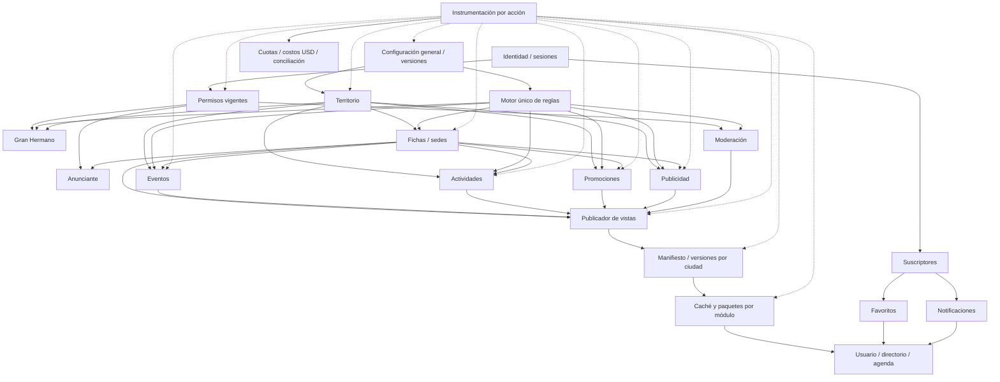

# Guía Local 2 — mapa de dependencias funcionales (base viva v1)

**Sentido de las flechas:** A → B = B necesita A; un cambio en A puede afectar B. Las relaciones detalladas se completan contra requisitos y comportamiento existentes, no se inventan. El diagrama es la base transversal, NO certifica haber inventariado cada campo actual.

## Qué significa cada cambio

| Origen de cambio | Quién lo inicia | Datos o reglas que consulta | Impacto posterior | Plazo | Medición imprescindible |
|---|---|---|---|---|---|
| País, provincia, ciudad | Gran Hermano autorizado | territorio, reglas de unicidad, permisos | catálogo, selectores, índices de ciudad, paquetes pertinentes | al confirmar | comprobación, escritura, publicación, lecturas derivadas, bytes |
| Nivel/funcionalidad/valor | Gran Hermano autorizado | catálogo de planes, dependencias y excepciones | formulario, prestaciones, límites, publicidad, precio y presentación | según regla | escritura de versión, evaluaciones e invalidaciones |
| Permiso del encargado | Propietario o Gran Hermano autorizado | identidad, relación con anunciante, rol | acceso a detalles, guardados y permisos delegados | **inmediato** | verificación, transacción, invalidación; prueba de acceso rechazado |
| Ficha de anunciante | propietario, delegado o Gran Hermano autorizado | permisos, nivel, cupo de edición, sedes, clasificación | vista privada, ficha pública, búsqueda, eventos/actividades/promociones/publicidad relacionados | guardado inmediato; publicación según política | validación, lectura, escritura, proyección, distribución |
| Sede | propietario, delegado o Gran Hermano autorizado | permisos de ficha, territorio, campos y reglas | ficha, búsqueda/localización, tarjetas públicas | según política | escritura, índices y paquetes afectados |
| Evento | creador autorizado / moderación | anunciante, territorio, categoría, publicación y cupos | agenda, publicidad vinculada, información del anunciante | según aprobación/vigencia | alta, edición, revisión y visualizaciones |
| Actividad | creador autorizado / moderación | anunciante, territorio, categorías, vigencia | agenda/actividades, publicidad, ficha relacionada | según política | alta, edición, revisión y visualizaciones |
| Promoción | anunciante autorizado / moderación | ficha, nivel, condiciones y vigencia | tarjetas, buscadores, exposición pública | según política | creación, cambio, vencimiento, presentación |
| Publicidad | anunciante elegible / Gran Hermano | niveles, contratos, formatos, frecuencia, relevancia | Guía, Eventos, Actividades y otros espacios habilitados | según contrato y vigencia | alta, edición, selección, impresiones si corresponde |
| Favorito | suscriptor autenticado | sesión, identidad, registro público | favoritos propios, interfaz de Usuario | inmediato | lectura/alta/baja y control de sesión |
| Cambio de ciudad en Usuario | usuario | catálogo/versiones y preferencias | descarga selectiva de datos públicos de ciudad | inmediato en cliente | peticiones, caché, transferencias, CPU disponible |

**Nota de dependencia:** un flujo puede volver sobre un módulo previo, por ejemplo `Fichas → Eventos → Publicador → vista del anunciante`. El grafo no impone linealidad ni exige reconsultar datos idénticos.

## Reglas para completar el grafo

Cada función debe registrar: **quién puede ejecutarla, disparador, entradas, fuente de verdad, reglas, escritura, evento emitido, módulos afectados, visibilidad, invalidez de caché y costo por operación**. Una dependencia no verificada se etiqueta pendiente, nunca se asume ausente.

El primer recorrido verificable será `Gran Hermano crea ciudad → reglas la validan → se guarda → se versiona y publica → Usuario la encuentra → visor presenta consumos y cuotas reales`. El recorrido se prueba completo antes de agregar las siguientes funcionalidades.
