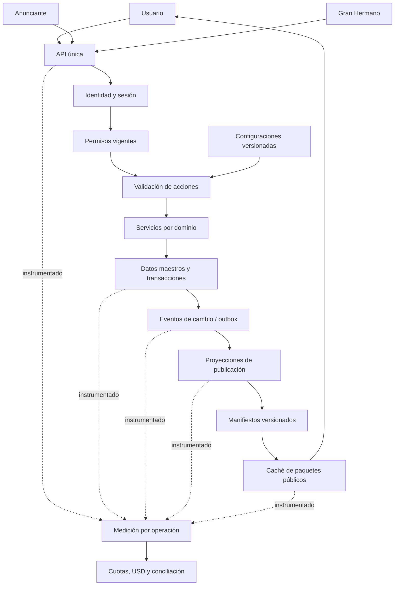
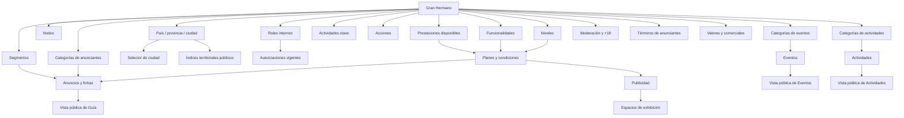

# GLD2 · MAPA DE DEPENDENCIAS — auditoría independiente de segundo pase
Estado: **NO APROBADO PARA IMPLEMENTACIÓN GLOBAL**. Revisado el 15/11/2026 contra `AGENTS.md`, `docs/CONTROL_MODULOS.md`, `plataforma/administracion.html` y `docs/PUBLICIDAD_CONTRATACION_Y_DISTRIBUCION_PENDIENTE.md` de main. No implica prueba de ejecución ni exhaustividad de los campos.

## Convención indispensable

- **C — confirmada:** se ve expresamente en UI o contrato del repositorio.
- **D — definida:** decisión de arquitectura GLD2, aún sin implementación ni prueba.
- **P — pendiente:** relación posible, **NO afirmarla como obligatoria**.
- Flecha A → B significa que **B consume el dato/regla A**. No significa automáticamente que un cambio de A exija reconstruir B: la invalidación depende de los campos realmente usados.
- La relación puede ser bidireccional y transitar varios módulos. La explicación de cada ruta debe identificar lectura, escritura, regla, origen, actor, caducidad e instrumentación.
- Cada dependencia debe tener identificador, evidencia y prueba de cambio. Un diagrama sin esas pruebas no acredita cobertura.

## Mapa 1: estructura técnica transversal (D, diseño aún no probado)

La capa de autorización controla mutaciones y accesos privados, **no obliga a consultar una base de permisos por cada lectura pública anónima**. La identidad no se impone indiscriminadamente a contenido abierto. La publicación no se interpreta como permiso para difundir antes del corte previsto.

## Mapa 2: configuración y producto (C en existencia; vínculos particulares P salvo que se indiquen)

**Precaución:** las flechas del mapa 2 representan candidatas de consumo por la función; las que no estén verificadas campo a campo siguen siendo **P**. Por ejemplo: `Nodos`, `Acciones`, `Actividades clave` y `Segmentos` existen, pero sus efectos exactos sobre cada pantalla deben localizarse en código y contrato antes de cerrar el mapa. El documento de Publicidad contiene explícitamente decisiones aún abiertas: no elevarlas a reglas técnicas aprobadas.

## Matriz de impacto por operación: fuente, consecuencia, urgencia, estado

| ID | Cambio | Quién y dónde | Lecturas/dependencias | Escritura o efecto | Cuándo | Evidencia/estado |
|---|---|---|---|---|---|---|
| DEP-01 | Crear/editar territorio | Gran Hermano, Configuración | sesión y rol; jerarquía territorial; reglas vigentes | maestro de país/provincia/ciudad, revisión de catálogo y vista pública | maestro al confirmar; publicación según política vigente | C existencia de controles y jerarquía; D mecanismo técnico |
| DEP-02 | Actualizar reglas de plataforma | Gran Hermano, Configuración | rol, versión anterior, dependencias del campo | regla versionada; invalidación selectiva | confirmar escritura; distribución conforme a política | C categorías de configuración; P impactos por campo |
| DEP-03 | Revocar encargado | propietario o Gran Hermano | relación con ficha, identidad, rol, permisos | permiso vigente y rechazo de posteriores accesos privados | **inmediato** | C requisito de negocio; D implementación |
| DEP-04 | Cambiar nivel o beneficios | Gran Hermano/autorizado | niveles, prestaciones, funcionalidades, adicionales, excepciones y contratación | derechos efectivos, representación de ficha, exposición comercial | según vigencia y política | C existencia de niveles/prestaciones; P contratos concretos |
| DEP-05 | Modificar ficha | propietario/delegado/GH con capacidad | permisos, límite de edición, clasificación, sede, versión | maestro y, si corresponde, futuras vistas públicas | límite de cambios al confirmar | C necesidad; P campos/efectos detallados |
| DEP-06 | Crear/editar sede | titular autorizado/GH | ficha madre, territorio, permisos, versión | sede y proyección cuando corresponda | política del módulo | C entidad y dependencia de ficha; P campos |
| DEP-07 | Crear/editar evento | anunciante u operador autorizado | reglas de evento, categoría, territorio, eventualmente anunciante | registro de evento, moderación, paquete de agenda | aprobación y corte aplicables | C funcionalidad; P vínculo obligatorio con anunciante, no asumirlo |
| DEP-08 | Crear/editar actividad | anunciante u operador autorizado | categoría, territorio, vigencia y reglas | actividad, moderación, proyección | aprobación y corte aplicables | C funcionalidad; P otros cruces |
| DEP-09 | Crear/editar promoción | anunciante autorizado | nivel, límites, ficha y catálogo aplicable | promoción y vistas habilitadas | política vigente | C funcionalidad; P relación exacta |
| DEP-10 | Gestionar publicidad | anunciante/GH autorizado | nivel, elegibilidad, ciudad, contrato, posiciones, relevancia, formato | contratación/creatividad y distribución | contrato, vigencia y publicación | C conceptos; **P decisiones de reglas aún abiertas** |
| DEP-11 | Favoritos | Usuario autenticado | identidad, anuncio publicado | relación privada Usuario↔registro | inmediato | C funcionalidad; P almacenamiento destino |
| DEP-12 | Cambiar ciudad/navegar | Usuario | catálogo y manifiesto público | lectura de paquetes y preferencias | al elegir; reutilizar sin cambios | C producto; D segmentación/versionado |
| DEP-13 | Notificaciones | Usuario/Anunciante/GH según caso | sesión y hechos relevantes | bandeja y estados de lectura | según evento | C funcionalidad; P disparadores exactos |
| DEP-14 | Soporte y reclamos | Anunciante/Usuario/GH según circuito | identidad, tipo de solicitud, roles y asignaciones | solicitud, bandeja, estados y avisos | según flujo | C existencia; P detalle |
| DEP-15 | Roles internos y asignaciones | Gran Hermano según capacidad | definición de rol, usuario y ámbito | permisos vigentes y efectos sobre acciones | seguridad inmediata | C UI; P matriz exhaustiva de capacidades |
| DEP-16 | Suscriptores | Usuario/GH | sesión, consentimiento, ciudad, reglas | perfil, preferencias y vistas autorizadas | según tipo de dato | C funcionalidad; P dependencias restantes |
| DEP-17 | Farmacias de turno | administración/fuente propia | ciclo/turno, territorio, vigencia | publicación específica de farmacia | vigencia/actualización propia | C funcionalidad diferenciada; P origen preciso |
| DEP-18 | Efemérides | administración/fuente propia | calendario, categorías/territorio si aplican | calendario publicado | corte/vigencia específica | C funcionalidad diferenciada; P origen preciso |
| DEP-19 | Empleo | módulos autorizados | reglas, clasificación y territorio | búsquedas/publicaciones de empleo | según política | C presencia en Gran Hermano; P contrato |
| DEP-20 | Información visual/identidad | Usuario, Anunciante y GH | diseño, colores, formato de tarjetas y reglas de presentación | renderización, recursos estáticos y egreso | por versión de interfaz | C requisito de preservación; P inventario de elementos |

## Correcciones del supervisor 2 que invalidan el grafo anterior

1. **Dependencias falsas:** se retiran como obligaciones universales `Ficha → Evento`, `Ficha → Actividad`, `Ficha → Publicidad`. Pueden existir vínculos por anunciante, pero no son universales ni obligan a reconstruir todos los módulos por cada cambio de ficha.
2. **Configuración incompleta:** se agregan Nodos, Segmentos, Actividades clave, Acciones, Categorías específicas, Roles internos, Términos y Moderación +18; también Valores y prestaciones.
3. **Módulos ausentes:** se incorporan Suscriptores, Notificaciones, Soporte, Farmacias, Efemérides, Empleo y relaciones visuales.
4. **Seguridad y lectura pública:** no toda lectura pública requiere sesión o verificación privada. Las operaciones privadas sí deben comprobar permiso vigente.
5. **Publicación diferida:** un outbox durable NO autoriza publicación inmediata si la regla comercial/operativa exige corte diario. Se separan escritura, autorización, programación y exposición.
6. **Costos y cuotas:** cada acción incluye procesos indirectos y servidor, y el costo de entregar paquetes y medios; el grafo obliga a incluir ambas direcciones de cambios sólo cuando estén verificadas.

## Puerta de aprobación del mapa

Por cada fila anterior completar un contrato verificable: campos maestros afectados, reglas, roles, caso real, entradas/salidas, dependencias C/P, caducidad, caché, invalidación, costo de lectura/escritura/borrado y prueba de propagación. Se debe comprobar el circuito de cada funcionalidad en los **tres planos pertinentes**, sin inventar un cuarto plano llamado Carcasa. **No aprobado** si sólo hay diagrama sin relaciones verificadas a nivel de datos. Primera cadena propuesta: `identidad GH → alta de país/provincia/ciudad → fuente maestra → preparación según corte → lectura pública → medición`.
